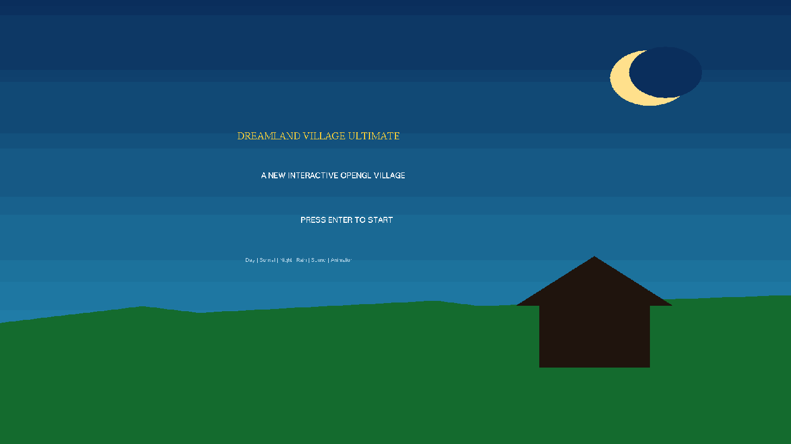
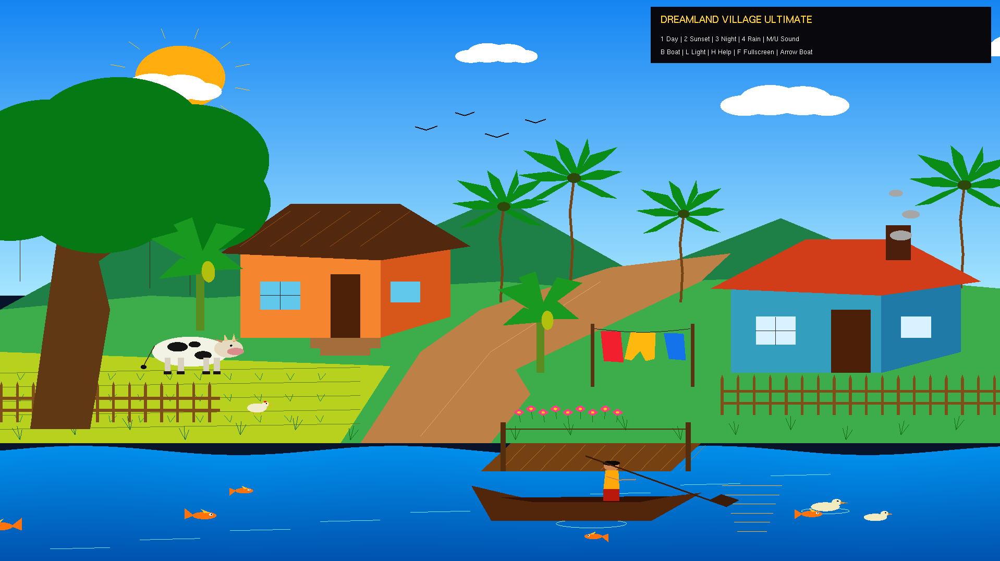
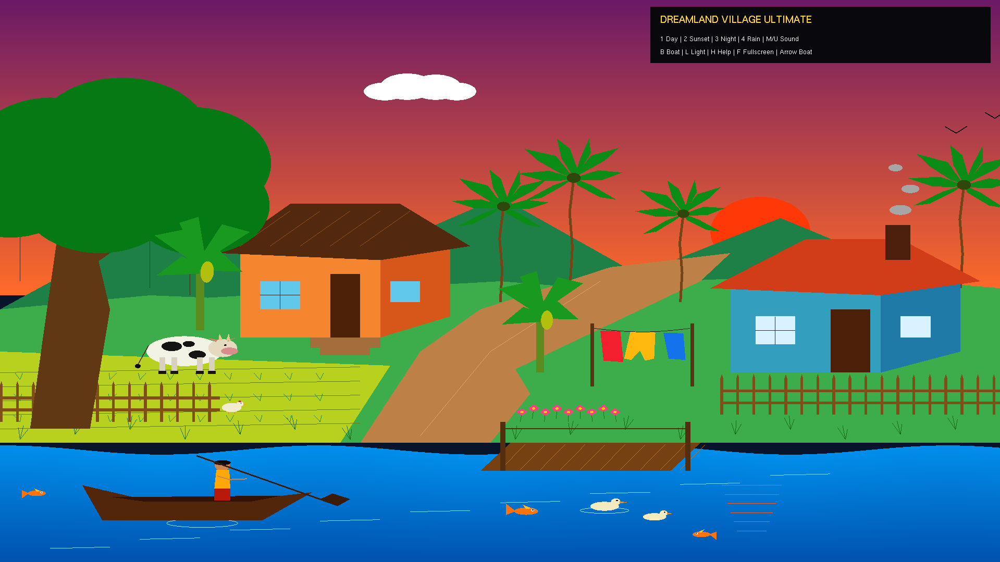
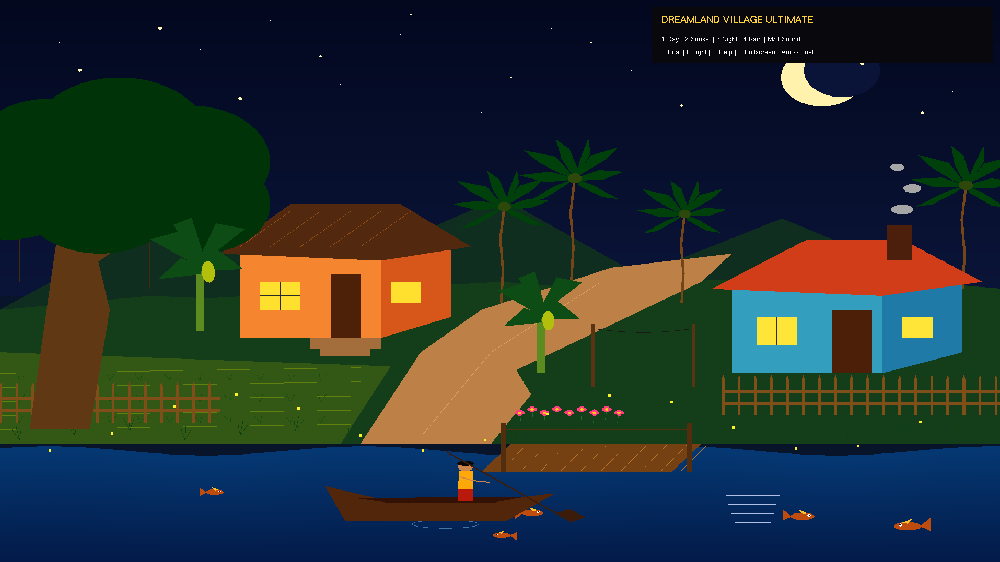
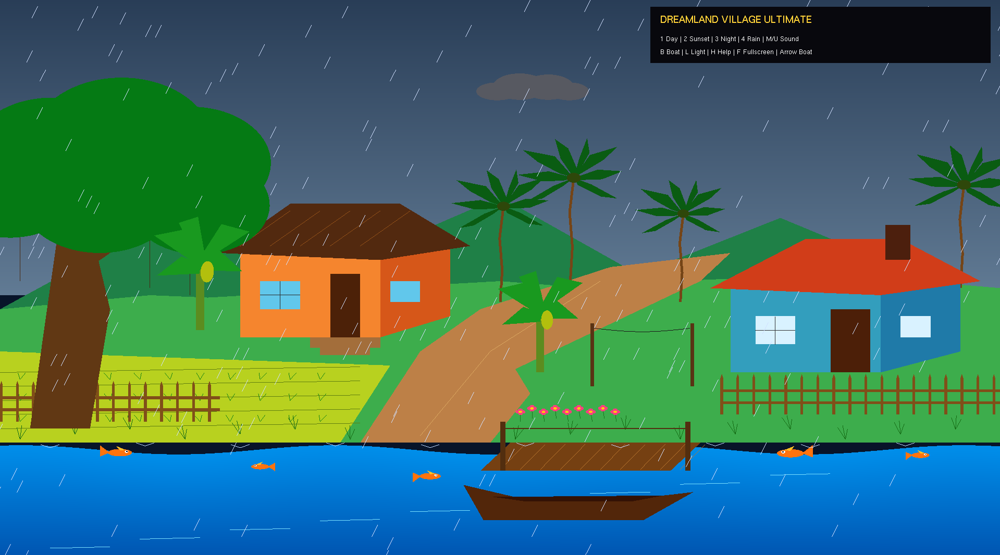

# Dreamland Village Ultimate

A C++ OpenGL computer graphics project that shows an animated Bangladeshi village with four scene modes: **Day**, **Sunset**, **Night** and **Rain**. It has moving clouds, birds, a walking cow, a rowing boat, fish, ducks, rain with lightning, and a different background sound for each scene.

Computer Graphics [A] – Final Term Project, Group 07 (AIUB).

**Semester:** Summer 2025-2026

## Features

- Day, Sunset, Night and Rain scenes with their own sounds.
- Boat that you can start, stop and steer.
- Moving clouds, birds, cow, chicken, fish, ducks, smoke, clothes, trees and water waves.
- Night scene with moon, twinkling stars, fireflies and house lights.
- Rain scene with falling rain, splashes, lightning and jumping fish.
- Help panel and fullscreen mode.

## Technologies Used

- C++ (C++11)
- OpenGL and GLU for drawing
- FreeGLUT 3.0.0 for the window, keyboard, mouse and timer (included in the project)
- Windows `PlaySound` (winmm) for the `.wav` background sounds

## Project Structure

```
ComputerGraphics-Dreamland-Village-Ultimate/
├── openglportable-64bit/
│   ├── freeglut/                  # FreeGLUT headers, libraries and DLL
│   └── openglportable/
│       ├── main.cpp               # all drawing, animation, sound and controls
│       ├── openglportable.cbp     # Code::Blocks project
│       └── bin/Debug/             # openglportable.exe, freeglut.dll and the .wav sounds
├── Final_Term_Project_Report.pdf  # project report
└── Screenshots/
```

## Requirements

- **Windows** (the sound uses Windows `PlaySound`)
- **64-bit MinGW g++ compiler** – easiest way is [Code::Blocks with MinGW](https://www.codeblocks.org/downloads/binaries/) (the `mingw-setup` installer), or [WinLibs](https://winlibs.com/)
- **VS Code** – download from [code.visualstudio.com](https://code.visualstudio.com/) with the **C/C++** extension

FreeGLUT is already included in the project, so you don't need to install it.

## Clone the Project

```bash
git clone https://github.com/munshi-rishad/ComputerGraphics-Dreamland-Village-Ultimate.git
```

## Setup and Run

1. Install the MinGW compiler and make sure `g++ --version` works in a new terminal.
   (With Code::Blocks, add `C:\Program Files\CodeBlocks\MinGW\bin` to the Windows `PATH`.)
2. Open VS Code, install the **C/C++** extension, then **File → Open Folder** and open the cloned project folder.
3. Open the terminal (**Terminal → New Terminal**) and go to the source folder:

   ```bash
   cd openglportable-64bit/openglportable
   ```

4. Build the program:

   ```bash
   g++ main.cpp -I../freeglut/include -L../freeglut/lib/x64 -lfreeglut -lopengl32 -lglu32 -lwinmm -o bin/Debug/openglportable.exe
   ```

5. Run it (the `.wav` sounds and `freeglut.dll` are in the same folder):

   ```bash
   cd bin/Debug
   ./openglportable.exe
   ```

6. Press **Enter** on the intro screen to start.

**Other ways to run:**

- **Code::Blocks:** open `openglportable-64bit/openglportable/openglportable.cbp` and press **F9** (Build and run).
- **Without building:** double-click `openglportable-64bit/openglportable/bin/Debug/openglportable.exe`.

## Controls

- `Enter` – start from the intro screen
- `1` / `2` / `3` / `4` – Day / Sunset / Night / Rain
- `B` – start or stop the boat
- `Left` / `Right` arrow – boat goes left / right
- `L` – house lights on / off
- `H` – show / hide the help panel
- `F` – fullscreen on / off
- `M` / `U` – sound off / on
- Mouse left / right / middle click – boat goes right / left / stops
- `Esc` – exit

## Project Video

[Watch the demo video on Google Drive](https://drive.google.com/file/d/1_UcEC8l-ug3ilsZQ2rCFEUmWVuPChvQw/view?usp=drive_link)

## Project Report

[Final_Term_Project_Report.pdf](Final_Term_Project_Report.pdf)

## Screenshots

### 1. Intro Screen

The start screen with the project title. Press Enter to begin.

<p align="center">
  
</p>

### 2. Day Scene

Blue sky, sun with rotating rays, paddy field, walking cow and the rowing boat.

<p align="center">
  
</p>

### 3. Sunset Scene

Purple-orange sky with the red sun going down.

<p align="center">
  
</p>

### 4. Night Scene

Dark sky with the moon, twinkling stars, fireflies and lit house windows.

<p align="center">
  
</p>

### 5. Rain Scene

Grey sky with falling rain, splashes, lightning and jumping fish.

<p align="center">
  
</p>
